# Design Document: FundedWealth Admin OS

## Overview

FundedWealth Admin OS is an enterprise-grade internal operating system for managing the entire FundedWealth proprietary trading firm. The system provides 18 specialized operating centers accessible at `admin.fundedwealth.com`, covering every operational domain from executive oversight to configuration management.

### Design Principles

- **Security-First**: Every layer enforces authentication, authorization, and audit
- **Modular Architecture**: Each operating center is an independent module with clear boundaries
- **Real-Time Operations**: Supabase Realtime powers live data updates across all centers
- **Scalability**: Stateless design supporting 500+ concurrent staff sessions
- **Compliance**: Immutable audit logging with 7-year retention

### Technology Stack

| Layer | Technology |
|-------|-----------|
| Framework | Next.js 14+ (App Router, SSR + CSR) |
| Language | TypeScript (strict mode) |
| Styling | Tailwind CSS + Design Tokens |
| Components | shadcn/ui |
| Database | Supabase (PostgreSQL 15+) |
| Auth | Supabase Auth + Custom 2FA |
| Realtime | Supabase Realtime (WebSocket) |
| Storage | Supabase Storage (KYC docs, certificates) |
| Deployment | Vercel (Edge + Serverless) |
| Monitoring | Supabase Dashboard + Custom Health Checks |


## Architecture

### Product Architecture

The Admin OS is structured as a multi-layered enterprise application with clear separation between presentation, business logic, data access, and infrastructure concerns.

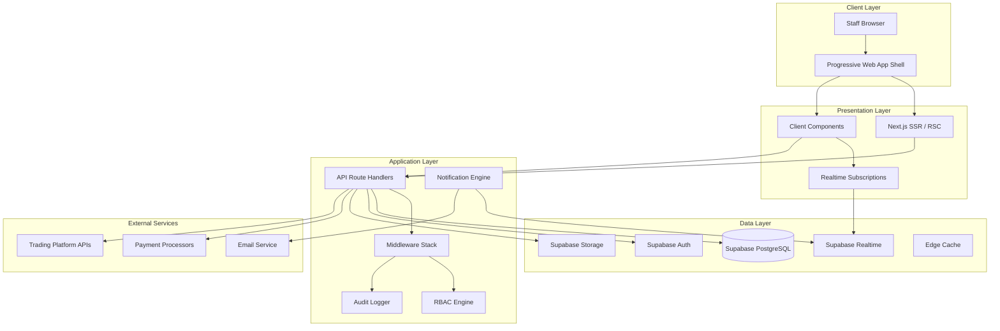


### Application Architecture

The application follows a layered architecture within each module:

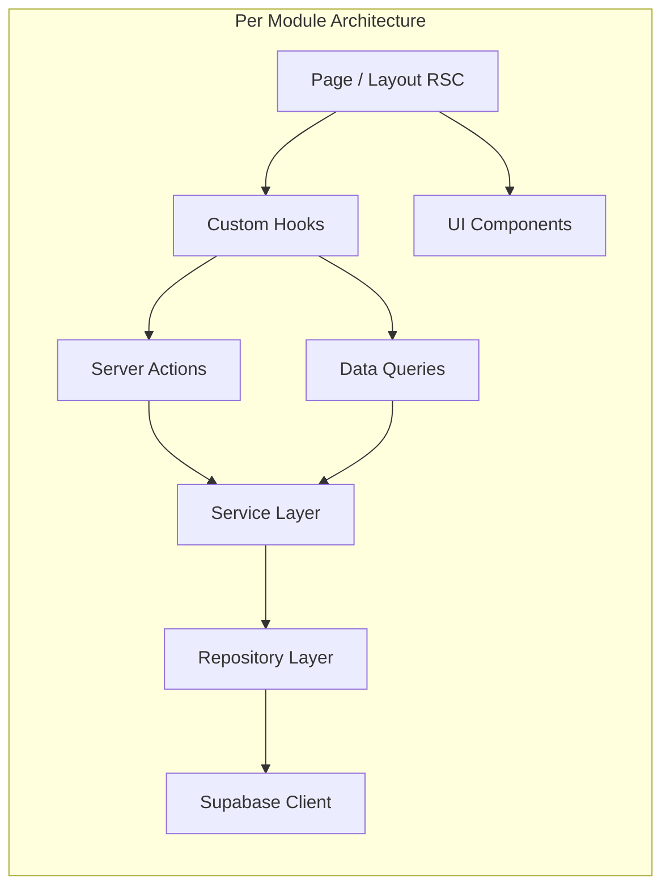

**Layer Responsibilities:**

| Layer | Responsibility | Location |
|-------|---------------|----------|
| Page/Layout | SSR rendering, route protection, data fetching | `app/(dashboard)/[center]/page.tsx` |
| Components | UI rendering, user interaction, optimistic updates | `modules/[center]/components/` |
| Hooks | Client-side state, realtime subscriptions, mutations | `modules/[center]/hooks/` |
| Server Actions | Validation, permission checks, business logic orchestration | `modules/[center]/actions/` |
| Service | Business rules, cross-module coordination | `modules/[center]/services/` |
| Repository | Database queries, Supabase SDK calls | `modules/[center]/repositories/` |

### Request Flow

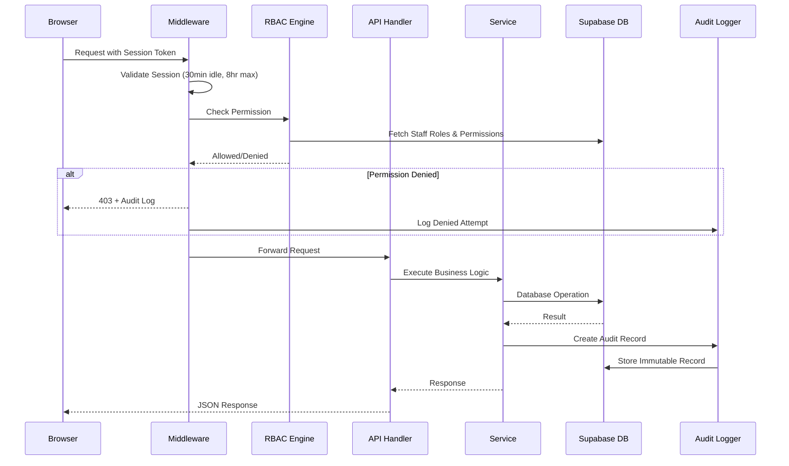


## Components and Interfaces

### Core Shared Components

#### RBAC Engine (`lib/rbac/`)

```typescript
// Permission format: resource.action
type Permission = `${Resource}.${Action}`;

type Resource = 'users' | 'payouts' | 'kyc' | 'risk' | 'settings' | 'challenges' 
  | 'trades' | 'affiliates' | 'support' | 'marketing' | 'audit' | 'staff' 
  | 'certificates' | 'system' | 'revenue';

type Action = 'view' | 'edit' | 'manage' | 'approve' | 'reject' | 'ban' | 'delete';

interface RBACEngine {
  hasPermission(staffId: string, permission: Permission): Promise<boolean>;
  hasAnyPermission(staffId: string, permissions: Permission[]): Promise<boolean>;
  getStaffPermissions(staffId: string): Promise<Permission[]>;
  getRolePermissions(roleId: string): Promise<Permission[]>;
  invalidatePermissionCache(staffId: string): void;
}
```

#### Audit Logger (`lib/audit/`)

```typescript
interface AuditRecord {
  id: string;
  actorId: string;
  actorRole: string;
  action: AuditAction;
  timestamp: string; // UTC ISO 8601 with ms precision
  targetEntityType: string;
  targetEntityId: string;
  previousState: Record<string, unknown> | null;
  newState: Record<string, unknown> | null;
  ipAddress: string;
  deviceInfo: DeviceInfo;
  batchId?: string;
  metadata?: Record<string, unknown>;
}

interface AuditLogger {
  log(record: Omit<AuditRecord, 'id' | 'timestamp'>): Promise<AuditRecord>;
  logBatch(records: Omit<AuditRecord, 'id' | 'timestamp' | 'batchId'>[]): Promise<AuditRecord[]>;
  query(filters: AuditQueryFilters): Promise<PaginatedResult<AuditRecord>>;
}
```

#### Notification Engine (`lib/notifications/`)

```typescript
interface Notification {
  id: string;
  recipientId: string;
  priority: 'critical' | 'high' | 'medium' | 'low';
  title: string;
  message: string;
  eventSource: string;
  linkTo: string;
  read: boolean;
  createdAt: string;
}

interface NotificationEngine {
  send(notification: Omit<Notification, 'id' | 'createdAt'>): Promise<void>;
  broadcast(permission: Permission, notification: Omit<Notification, 'id' | 'recipientId' | 'createdAt'>): Promise<void>;
  markRead(notificationId: string, staffId: string): Promise<void>;
  getUnread(staffId: string): Promise<Notification[]>;
}
```


#### Session Manager (`lib/session/`)

```typescript
interface Session {
  id: string;
  staffId: string;
  token: string;
  deviceFingerprint: string;
  browser: string;
  os: string;
  ipAddress: string;
  geolocation: string;
  createdAt: string;
  lastActivity: string;
  expiresAt: string; // Max 8 hours from creation
}

interface SessionManager {
  create(staffId: string, deviceInfo: DeviceInfo): Promise<Session>;
  validate(token: string): Promise<Session | null>;
  refresh(token: string): Promise<Session>;
  invalidate(sessionId: string): Promise<void>;
  invalidateAll(staffId: string): Promise<void>;
  getActiveSessions(staffId: string): Promise<Session[]>;
}
```

#### Rate Limiter (`lib/rate-limit/`)

```typescript
interface RateLimitConfig {
  readLimit: number;  // Default: 100/min
  writeLimit: number; // Default: 30/min
  windowMs: number;   // 60000ms (1 minute)
}

interface RateLimiter {
  check(staffId: string, endpoint: string, type: 'read' | 'write'): Promise<RateLimitResult>;
  getRemainingRequests(staffId: string, type: 'read' | 'write'): Promise<number>;
}

interface RateLimitResult {
  allowed: boolean;
  remaining: number;
  resetInSeconds: number;
}
```

### Module Interfaces

Each operating center module exposes a consistent interface:

```typescript
// Module contract - every operating center implements this
interface OperatingCenterModule {
  // Route definitions
  routes: RouteDefinition[];
  // Required permissions to access the module
  requiredPermission: Permission;
  // Sidebar configuration
  navigation: NavigationItem;
  // Search integration
  searchProvider: SearchProvider;
}

interface SearchProvider {
  entityType: string;
  search(query: string, limit: number): Promise<SearchResult[]>;
  getSearchableFields(): string[];
}

interface NavigationItem {
  label: string;
  icon: string;
  href: string;
  badgeQuery?: () => Promise<number>; // Pending/unresolved count
  children?: NavigationItem[];
}
```


## Data Models

### Database Architecture (Supabase/PostgreSQL)

#### Entity Relationship Diagram

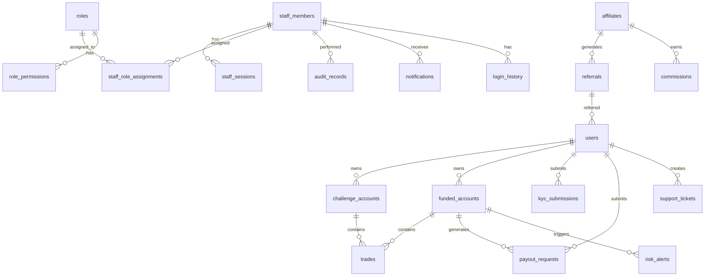

### Core Schema Definitions

#### Authentication & Authorization

```sql
-- Staff Members
CREATE TABLE staff_members (
    id UUID PRIMARY KEY DEFAULT gen_random_uuid(),
    email VARCHAR(255) UNIQUE NOT NULL,
    name VARCHAR(100) NOT NULL,
    password_hash TEXT NOT NULL,
    totp_secret TEXT,
    totp_enabled BOOLEAN DEFAULT FALSE,
    status VARCHAR(20) DEFAULT 'active' CHECK (status IN ('active', 'disabled', 'locked')),
    failed_login_attempts INTEGER DEFAULT 0,
    locked_until TIMESTAMPTZ,
    force_password_change BOOLEAN DEFAULT FALSE,
    temp_password_expires_at TIMESTAMPTZ,
    created_at TIMESTAMPTZ DEFAULT NOW(),
    updated_at TIMESTAMPTZ DEFAULT NOW()
);

-- Roles
CREATE TABLE roles (
    id UUID PRIMARY KEY DEFAULT gen_random_uuid(),
    name VARCHAR(50) UNIQUE NOT NULL CHECK (char_length(name) >= 3),
    description TEXT,
    is_system_role BOOLEAN DEFAULT FALSE, -- System roles cannot be deleted
    created_at TIMESTAMPTZ DEFAULT NOW(),
    updated_at TIMESTAMPTZ DEFAULT NOW()
);

-- Role Permissions
CREATE TABLE role_permissions (
    id UUID PRIMARY KEY DEFAULT gen_random_uuid(),
    role_id UUID NOT NULL REFERENCES roles(id) ON DELETE CASCADE,
    permission VARCHAR(100) NOT NULL, -- Format: resource.action
    created_at TIMESTAMPTZ DEFAULT NOW(),
    UNIQUE(role_id, permission)
);

-- Staff Role Assignments
CREATE TABLE staff_role_assignments (
    id UUID PRIMARY KEY DEFAULT gen_random_uuid(),
    staff_id UUID NOT NULL REFERENCES staff_members(id) ON DELETE CASCADE,
    role_id UUID NOT NULL REFERENCES roles(id) ON DELETE CASCADE,
    assigned_by UUID NOT NULL REFERENCES staff_members(id),
    assigned_at TIMESTAMPTZ DEFAULT NOW(),
    UNIQUE(staff_id, role_id)
);
```


```sql
-- Sessions
CREATE TABLE staff_sessions (
    id UUID PRIMARY KEY DEFAULT gen_random_uuid(),
    staff_id UUID NOT NULL REFERENCES staff_members(id) ON DELETE CASCADE,
    token_hash TEXT NOT NULL UNIQUE,
    device_fingerprint VARCHAR(255),
    browser VARCHAR(100),
    os VARCHAR(100),
    ip_address INET NOT NULL,
    geolocation VARCHAR(255),
    is_new_device BOOLEAN DEFAULT FALSE,
    created_at TIMESTAMPTZ DEFAULT NOW(),
    last_activity TIMESTAMPTZ DEFAULT NOW(),
    expires_at TIMESTAMPTZ NOT NULL, -- Max 8 hours from creation
    invalidated_at TIMESTAMPTZ
);

-- Login History
CREATE TABLE login_history (
    id UUID PRIMARY KEY DEFAULT gen_random_uuid(),
    staff_id UUID NOT NULL REFERENCES staff_members(id),
    ip_address INET NOT NULL,
    device_fingerprint VARCHAR(255),
    browser VARCHAR(100),
    os VARCHAR(100),
    geolocation VARCHAR(255),
    success BOOLEAN NOT NULL,
    failure_reason VARCHAR(100),
    is_new_device BOOLEAN DEFAULT FALSE,
    created_at TIMESTAMPTZ DEFAULT NOW()
);

-- Known Devices
CREATE TABLE staff_devices (
    id UUID PRIMARY KEY DEFAULT gen_random_uuid(),
    staff_id UUID NOT NULL REFERENCES staff_members(id) ON DELETE CASCADE,
    device_fingerprint VARCHAR(255) NOT NULL,
    device_name VARCHAR(100),
    browser VARCHAR(100),
    os VARCHAR(100),
    first_seen_at TIMESTAMPTZ DEFAULT NOW(),
    last_seen_at TIMESTAMPTZ DEFAULT NOW(),
    UNIQUE(staff_id, device_fingerprint)
);

-- Indexes
CREATE INDEX idx_staff_sessions_staff_id ON staff_sessions(staff_id);
CREATE INDEX idx_staff_sessions_token ON staff_sessions(token_hash);
CREATE INDEX idx_login_history_staff_id ON login_history(staff_id, created_at DESC);
CREATE INDEX idx_login_history_retention ON login_history(created_at);
```

#### Audit System

```sql
-- Audit Records (Immutable - no UPDATE/DELETE policies)
CREATE TABLE audit_records (
    id UUID PRIMARY KEY DEFAULT gen_random_uuid(),
    actor_id UUID NOT NULL REFERENCES staff_members(id),
    actor_role VARCHAR(100) NOT NULL,
    action VARCHAR(100) NOT NULL,
    timestamp TIMESTAMPTZ DEFAULT NOW() NOT NULL,
    target_entity_type VARCHAR(100) NOT NULL,
    target_entity_id VARCHAR(255) NOT NULL,
    previous_state JSONB,
    new_state JSONB,
    ip_address INET NOT NULL,
    device_info JSONB NOT NULL,
    batch_id UUID,
    metadata JSONB,
    missing_permission VARCHAR(100) -- For denied attempts
);

-- Partition by month for 7-year retention performance
-- CREATE TABLE audit_records_y2024m01 PARTITION OF audit_records
--     FOR VALUES FROM ('2024-01-01') TO ('2024-02-01');

CREATE INDEX idx_audit_actor ON audit_records(actor_id, timestamp DESC);
CREATE INDEX idx_audit_action ON audit_records(action, timestamp DESC);
CREATE INDEX idx_audit_target ON audit_records(target_entity_type, target_entity_id, timestamp DESC);
CREATE INDEX idx_audit_batch ON audit_records(batch_id) WHERE batch_id IS NOT NULL;
CREATE INDEX idx_audit_timestamp ON audit_records(timestamp DESC);
CREATE INDEX idx_audit_ip ON audit_records(ip_address);

-- Prevent modification/deletion of audit records
CREATE OR REPLACE FUNCTION prevent_audit_modification()
RETURNS TRIGGER AS $$
BEGIN
    RAISE EXCEPTION 'Audit records are immutable and cannot be modified or deleted';
END;
$$ LANGUAGE plpgsql;

CREATE TRIGGER audit_immutable_update
    BEFORE UPDATE ON audit_records FOR EACH ROW
    EXECUTE FUNCTION prevent_audit_modification();

CREATE TRIGGER audit_immutable_delete
    BEFORE DELETE ON audit_records FOR EACH ROW
    EXECUTE FUNCTION prevent_audit_modification();
```


#### User & Trading Domain

```sql
-- Users (Traders)
CREATE TABLE users (
    id UUID PRIMARY KEY DEFAULT gen_random_uuid(),
    email VARCHAR(255) UNIQUE NOT NULL,
    username VARCHAR(100),
    phone VARCHAR(50),
    first_name VARCHAR(100),
    last_name VARCHAR(100),
    country VARCHAR(100),
    kyc_status VARCHAR(20) DEFAULT 'pending' 
        CHECK (kyc_status IN ('pending', 'submitted', 'verified', 'rejected')),
    account_status VARCHAR(20) DEFAULT 'active'
        CHECK (account_status IN ('active', 'suspended', 'banned', 'deactivated')),
    ban_reason TEXT,
    referred_by UUID REFERENCES affiliates(id),
    last_login_at TIMESTAMPTZ,
    last_activity_at TIMESTAMPTZ,
    created_at TIMESTAMPTZ DEFAULT NOW(),
    updated_at TIMESTAMPTZ DEFAULT NOW()
);

-- Challenge Accounts
CREATE TABLE challenge_accounts (
    id UUID PRIMARY KEY DEFAULT gen_random_uuid(),
    user_id UUID NOT NULL REFERENCES users(id),
    account_number VARCHAR(50) UNIQUE NOT NULL,
    challenge_type VARCHAR(50) NOT NULL,
    phase INTEGER NOT NULL DEFAULT 1,
    status VARCHAR(20) NOT NULL DEFAULT 'active'
        CHECK (status IN ('active', 'passed', 'failed', 'expired', 'archived')),
    initial_balance DECIMAL(15,2) NOT NULL,
    current_balance DECIMAL(15,2) NOT NULL,
    profit_target_pct DECIMAL(5,2) NOT NULL,
    daily_drawdown_limit_pct DECIMAL(5,2) NOT NULL,
    max_drawdown_limit_pct DECIMAL(5,2) NOT NULL,
    min_trading_days INTEGER NOT NULL,
    max_trading_days INTEGER,
    trading_days_completed INTEGER DEFAULT 0,
    profit_pct DECIMAL(8,4) DEFAULT 0,
    max_daily_drawdown_pct DECIMAL(8,4) DEFAULT 0,
    max_drawdown_pct DECIMAL(8,4) DEFAULT 0,
    started_at TIMESTAMPTZ DEFAULT NOW(),
    completed_at TIMESTAMPTZ,
    expires_at TIMESTAMPTZ,
    created_at TIMESTAMPTZ DEFAULT NOW(),
    updated_at TIMESTAMPTZ DEFAULT NOW()
);

-- Funded Accounts
CREATE TABLE funded_accounts (
    id UUID PRIMARY KEY DEFAULT gen_random_uuid(),
    user_id UUID NOT NULL REFERENCES users(id),
    account_number VARCHAR(50) UNIQUE NOT NULL,
    challenge_account_id UUID REFERENCES challenge_accounts(id),
    account_size DECIMAL(15,2) NOT NULL,
    current_equity DECIMAL(15,2) NOT NULL,
    profit_loss DECIMAL(15,2) DEFAULT 0,
    profit_split_pct DECIMAL(5,2) NOT NULL DEFAULT 80.00,
    daily_drawdown_limit_pct DECIMAL(5,2) NOT NULL,
    max_drawdown_limit_pct DECIMAL(5,2) NOT NULL,
    daily_drawdown_used_pct DECIMAL(8,4) DEFAULT 0,
    max_drawdown_used_pct DECIMAL(8,4) DEFAULT 0,
    violation_count INTEGER DEFAULT 0,
    payout_eligible BOOLEAN DEFAULT FALSE,
    ineligibility_reason TEXT,
    status VARCHAR(20) DEFAULT 'active'
        CHECK (status IN ('active', 'suspended', 'breached', 'closed')),
    funded_at TIMESTAMPTZ DEFAULT NOW(),
    created_at TIMESTAMPTZ DEFAULT NOW(),
    updated_at TIMESTAMPTZ DEFAULT NOW()
);

-- Trades
CREATE TABLE trades (
    id UUID PRIMARY KEY DEFAULT gen_random_uuid(),
    account_id UUID NOT NULL, -- References challenge or funded account
    account_type VARCHAR(10) NOT NULL CHECK (account_type IN ('challenge', 'funded')),
    symbol VARCHAR(20) NOT NULL,
    direction VARCHAR(5) NOT NULL CHECK (direction IN ('buy', 'sell')),
    lot_size DECIMAL(10,4) NOT NULL,
    entry_price DECIMAL(15,5) NOT NULL,
    exit_price DECIMAL(15,5),
    profit_loss DECIMAL(15,2),
    commission DECIMAL(10,2) DEFAULT 0,
    swap DECIMAL(10,2) DEFAULT 0,
    status VARCHAR(10) DEFAULT 'open' CHECK (status IN ('open', 'closed')),
    opened_at TIMESTAMPTZ NOT NULL,
    closed_at TIMESTAMPTZ,
    duration_seconds INTEGER,
    created_at TIMESTAMPTZ DEFAULT NOW()
);

CREATE INDEX idx_trades_account ON trades(account_id, account_type, opened_at DESC);
CREATE INDEX idx_trades_symbol ON trades(symbol, opened_at DESC);
CREATE INDEX idx_trades_user_lookup ON trades(account_id, status);
```


#### Orders

```sql
CREATE TABLE orders (
    id UUID PRIMARY KEY DEFAULT gen_random_uuid(),
    account_id UUID NOT NULL,
    account_type VARCHAR(10) NOT NULL CHECK (account_type IN ('challenge', 'funded')),
    user_id UUID NOT NULL REFERENCES users(id),
    symbol VARCHAR(20) NOT NULL,
    order_type VARCHAR(20) NOT NULL 
        CHECK (order_type IN ('market', 'limit', 'stop', 'stop_limit')),
    direction VARCHAR(5) NOT NULL CHECK (direction IN ('buy', 'sell')),
    volume DECIMAL(10,4) NOT NULL,
    price DECIMAL(15,5),
    status VARCHAR(20) NOT NULL DEFAULT 'open'
        CHECK (status IN ('open', 'filled', 'cancelled', 'rejected')),
    rejection_reason TEXT,
    acknowledged BOOLEAN DEFAULT FALSE,
    submitted_at TIMESTAMPTZ NOT NULL DEFAULT NOW(),
    executed_at TIMESTAMPTZ,
    fill_time_ms INTEGER,
    created_at TIMESTAMPTZ DEFAULT NOW()
);

CREATE INDEX idx_orders_status ON orders(status, submitted_at DESC);
CREATE INDEX idx_orders_account ON orders(account_id, submitted_at DESC);
```

#### Payouts

```sql
CREATE TABLE payout_requests (
    id UUID PRIMARY KEY DEFAULT gen_random_uuid(),
    user_id UUID NOT NULL REFERENCES users(id),
    funded_account_id UUID NOT NULL REFERENCES funded_accounts(id),
    requested_amount DECIMAL(15,2) NOT NULL 
        CHECK (requested_amount BETWEEN 0.01 AND 999999999.99),
    profit_share_pct DECIMAL(5,2) NOT NULL,
    calculated_payout DECIMAL(15,2) NOT NULL,
    account_pnl_since_last_payout DECIMAL(15,2),
    status VARCHAR(30) NOT NULL DEFAULT 'request_received'
        CHECK (status IN ('request_received', 'under_review', 'approved', 
                          'payment_processing', 'payment_completed', 'payment_failed')),
    eligibility_status VARCHAR(20) NOT NULL,
    eligibility_reason TEXT,
    payment_method VARCHAR(50),
    transaction_reference VARCHAR(255),
    rejection_reason TEXT,
    failure_reason TEXT,
    reviewer_id UUID REFERENCES staff_members(id),
    approver_id UUID REFERENCES staff_members(id),
    reviewed_at TIMESTAMPTZ,
    approved_at TIMESTAMPTZ,
    completed_at TIMESTAMPTZ,
    created_at TIMESTAMPTZ DEFAULT NOW(),
    updated_at TIMESTAMPTZ DEFAULT NOW()
);

-- Payout history is append-only (no updates allowed after finalization)
CREATE TABLE payout_status_history (
    id UUID PRIMARY KEY DEFAULT gen_random_uuid(),
    payout_id UUID NOT NULL REFERENCES payout_requests(id),
    previous_status VARCHAR(30),
    new_status VARCHAR(30) NOT NULL,
    changed_by UUID NOT NULL REFERENCES staff_members(id),
    reason TEXT,
    created_at TIMESTAMPTZ DEFAULT NOW()
);

CREATE INDEX idx_payouts_status ON payout_requests(status, created_at DESC);
CREATE INDEX idx_payouts_user ON payout_requests(user_id, created_at DESC);
```


#### KYC System

```sql
CREATE TABLE kyc_submissions (
    id UUID PRIMARY KEY DEFAULT gen_random_uuid(),
    user_id UUID NOT NULL REFERENCES users(id),
    status VARCHAR(20) NOT NULL DEFAULT 'pending'
        CHECK (status IN ('pending', 'in_review', 'approved', 'rejected', 'resubmit_requested')),
    submission_count INTEGER DEFAULT 1 CHECK (submission_count <= 3),
    reviewer_id UUID REFERENCES staff_members(id),
    review_started_at TIMESTAMPTZ,
    reviewed_at TIMESTAMPTZ,
    rejection_reasons TEXT[],
    resubmit_instructions TEXT,
    escalated BOOLEAN DEFAULT FALSE,
    overdue BOOLEAN DEFAULT FALSE,
    created_at TIMESTAMPTZ DEFAULT NOW(),
    updated_at TIMESTAMPTZ DEFAULT NOW()
);

CREATE TABLE kyc_documents (
    id UUID PRIMARY KEY DEFAULT gen_random_uuid(),
    submission_id UUID NOT NULL REFERENCES kyc_submissions(id) ON DELETE CASCADE,
    document_type VARCHAR(50) NOT NULL
        CHECK (document_type IN ('government_id_front', 'government_id_back', 
                                  'proof_of_address', 'selfie_with_id', 'additional')),
    storage_path TEXT NOT NULL,
    file_name VARCHAR(255),
    file_size INTEGER,
    mime_type VARCHAR(100),
    uploaded_at TIMESTAMPTZ DEFAULT NOW()
);

CREATE INDEX idx_kyc_status ON kyc_submissions(status, created_at DESC);
CREATE INDEX idx_kyc_overdue ON kyc_submissions(overdue, status) WHERE overdue = TRUE;
```

#### Risk Management

```sql
CREATE TABLE risk_alerts (
    id UUID PRIMARY KEY DEFAULT gen_random_uuid(),
    account_id UUID NOT NULL,
    account_type VARCHAR(10) NOT NULL,
    user_id UUID NOT NULL REFERENCES users(id),
    alert_type VARCHAR(50) NOT NULL,
    severity VARCHAR(10) NOT NULL 
        CHECK (severity IN ('low', 'medium', 'high', 'critical')),
    original_severity VARCHAR(10),
    breach_type VARCHAR(50),
    breach_amount DECIMAL(15,2),
    threshold_violated DECIMAL(15,2),
    status VARCHAR(20) DEFAULT 'open'
        CHECK (status IN ('open', 'acknowledged', 'resolved', 'escalated')),
    acknowledged_by UUID REFERENCES staff_members(id),
    resolved_by UUID REFERENCES staff_members(id),
    resolution_outcome VARCHAR(50)
        CHECK (resolution_outcome IN ('account_suspended', 'rule_adjusted', 
                                       'false_positive', 'escalated')),
    action_taken TEXT,
    escalated_at TIMESTAMPTZ,
    acknowledged_at TIMESTAMPTZ,
    resolved_at TIMESTAMPTZ,
    created_at TIMESTAMPTZ DEFAULT NOW()
);

CREATE INDEX idx_risk_severity ON risk_alerts(severity DESC, status, created_at DESC);
CREATE INDEX idx_risk_status ON risk_alerts(status, created_at DESC);
CREATE INDEX idx_risk_account ON risk_alerts(account_id, account_type);
CREATE INDEX idx_risk_escalation ON risk_alerts(status, created_at) 
    WHERE status = 'open';
```


#### Affiliates & Commissions

```sql
CREATE TABLE affiliates (
    id UUID PRIMARY KEY DEFAULT gen_random_uuid(),
    user_id UUID REFERENCES users(id),
    name VARCHAR(200) NOT NULL,
    email VARCHAR(255) UNIQUE NOT NULL,
    affiliate_code VARCHAR(50) UNIQUE NOT NULL,
    commission_structure_id UUID REFERENCES commission_structures(id),
    total_referrals INTEGER DEFAULT 0,
    total_revenue_generated DECIMAL(15,2) DEFAULT 0,
    commission_earned DECIMAL(15,2) DEFAULT 0,
    commission_paid DECIMAL(15,2) DEFAULT 0,
    commission_pending DECIMAL(15,2) DEFAULT 0,
    status VARCHAR(20) DEFAULT 'active'
        CHECK (status IN ('active', 'suspended', 'terminated')),
    created_at TIMESTAMPTZ DEFAULT NOW(),
    updated_at TIMESTAMPTZ DEFAULT NOW()
);

CREATE TABLE commission_structures (
    id UUID PRIMARY KEY DEFAULT gen_random_uuid(),
    name VARCHAR(100) NOT NULL,
    type VARCHAR(20) NOT NULL 
        CHECK (type IN ('flat_rate', 'percentage', 'tiered', 'recurring')),
    config JSONB NOT NULL, -- Flexible structure for different types
    created_at TIMESTAMPTZ DEFAULT NOW(),
    updated_at TIMESTAMPTZ DEFAULT NOW()
);

CREATE TABLE referrals (
    id UUID PRIMARY KEY DEFAULT gen_random_uuid(),
    affiliate_id UUID NOT NULL REFERENCES affiliates(id),
    referred_user_id UUID NOT NULL REFERENCES users(id),
    purchase_id UUID,
    purchase_amount DECIMAL(15,2),
    converted BOOLEAN DEFAULT FALSE,
    converted_at TIMESTAMPTZ,
    created_at TIMESTAMPTZ DEFAULT NOW()
);

CREATE TABLE commissions (
    id UUID PRIMARY KEY DEFAULT gen_random_uuid(),
    affiliate_id UUID NOT NULL REFERENCES affiliates(id),
    referral_id UUID REFERENCES referrals(id),
    amount DECIMAL(15,2) NOT NULL,
    type VARCHAR(20) NOT NULL CHECK (type IN ('earned', 'reversal', 'payout')),
    status VARCHAR(20) DEFAULT 'pending'
        CHECK (status IN ('pending', 'approved', 'paid', 'reversed')),
    payout_request_id UUID,
    created_at TIMESTAMPTZ DEFAULT NOW()
);

CREATE INDEX idx_affiliates_code ON affiliates(affiliate_code);
CREATE INDEX idx_commissions_affiliate ON commissions(affiliate_id, status);
```

#### Support System

```sql
CREATE TABLE support_tickets (
    id UUID PRIMARY KEY DEFAULT gen_random_uuid(),
    ticket_number VARCHAR(20) UNIQUE NOT NULL,
    user_id UUID NOT NULL REFERENCES users(id),
    subject VARCHAR(255) NOT NULL,
    category VARCHAR(50) NOT NULL,
    priority VARCHAR(10) NOT NULL 
        CHECK (priority IN ('low', 'medium', 'high', 'critical')),
    status VARCHAR(20) NOT NULL DEFAULT 'open'
        CHECK (status IN ('open', 'in_progress', 'escalated', 'resolved', 'closed')),
    assigned_agent_id UUID REFERENCES staff_members(id),
    escalation_reason TEXT,
    escalated_to_team VARCHAR(100),
    sla_breached BOOLEAN DEFAULT FALSE,
    resolution_time_seconds INTEGER,
    satisfaction_rating INTEGER CHECK (satisfaction_rating BETWEEN 1 AND 5),
    resolved_at TIMESTAMPTZ,
    created_at TIMESTAMPTZ DEFAULT NOW(),
    updated_at TIMESTAMPTZ DEFAULT NOW()
);

CREATE TABLE ticket_messages (
    id UUID PRIMARY KEY DEFAULT gen_random_uuid(),
    ticket_id UUID NOT NULL REFERENCES support_tickets(id),
    sender_type VARCHAR(10) NOT NULL CHECK (sender_type IN ('user', 'staff')),
    sender_id UUID NOT NULL,
    message TEXT NOT NULL,
    attachments JSONB,
    created_at TIMESTAMPTZ DEFAULT NOW()
);

CREATE INDEX idx_tickets_status ON support_tickets(status, priority DESC, created_at);
CREATE INDEX idx_tickets_agent ON support_tickets(assigned_agent_id, status);
CREATE INDEX idx_tickets_sla ON support_tickets(sla_breached, status) 
    WHERE sla_breached = TRUE;
```


#### Marketing & Configuration

```sql
CREATE TABLE promotions (
    id UUID PRIMARY KEY DEFAULT gen_random_uuid(),
    name VARCHAR(100) NOT NULL,
    description VARCHAR(500),
    discount_type VARCHAR(10) NOT NULL CHECK (discount_type IN ('percentage', 'fixed')),
    discount_value DECIMAL(15,2) NOT NULL,
    applicable_challenge_types TEXT[],
    start_date TIMESTAMPTZ NOT NULL,
    end_date TIMESTAMPTZ NOT NULL,
    usage_limit INTEGER CHECK (usage_limit BETWEEN 1 AND 1000000),
    usage_count INTEGER DEFAULT 0,
    status VARCHAR(10) DEFAULT 'draft'
        CHECK (status IN ('draft', 'active', 'expired', 'disabled')),
    created_at TIMESTAMPTZ DEFAULT NOW(),
    updated_at TIMESTAMPTZ DEFAULT NOW(),
    CONSTRAINT valid_discount CHECK (
        (discount_type = 'percentage' AND discount_value BETWEEN 1 AND 100) OR
        (discount_type = 'fixed' AND discount_value BETWEEN 0.01 AND 999999.99)
    )
);

CREATE TABLE coupon_codes (
    id UUID PRIMARY KEY DEFAULT gen_random_uuid(),
    code VARCHAR(32) UNIQUE NOT NULL CHECK (char_length(code) >= 4),
    discount_type VARCHAR(10) NOT NULL CHECK (discount_type IN ('percentage', 'fixed')),
    discount_value DECIMAL(15,2) NOT NULL,
    start_date TIMESTAMPTZ NOT NULL,
    end_date TIMESTAMPTZ NOT NULL,
    usage_limit_per_user INTEGER CHECK (usage_limit_per_user BETWEEN 1 AND 100),
    total_usage_limit INTEGER CHECK (total_usage_limit BETWEEN 1 AND 1000000),
    total_usage_count INTEGER DEFAULT 0,
    min_purchase_amount DECIMAL(15,2) DEFAULT 0 
        CHECK (min_purchase_amount BETWEEN 0 AND 999999.99),
    status VARCHAR(10) DEFAULT 'active'
        CHECK (status IN ('active', 'expired', 'disabled')),
    created_at TIMESTAMPTZ DEFAULT NOW(),
    updated_at TIMESTAMPTZ DEFAULT NOW()
);

CREATE TABLE announcements (
    id UUID PRIMARY KEY DEFAULT gen_random_uuid(),
    title VARCHAR(150) NOT NULL,
    content TEXT NOT NULL CHECK (char_length(content) <= 5000),
    target_audience VARCHAR(20) NOT NULL
        CHECK (target_audience IN ('all_users', 'active_traders', 'funded_traders', 'affiliates')),
    start_date TIMESTAMPTZ NOT NULL,
    end_date TIMESTAMPTZ NOT NULL,
    priority VARCHAR(10) NOT NULL 
        CHECK (priority IN ('low', 'medium', 'high', 'critical')),
    created_by UUID NOT NULL REFERENCES staff_members(id),
    created_at TIMESTAMPTZ DEFAULT NOW(),
    updated_at TIMESTAMPTZ DEFAULT NOW()
);

-- Configuration Engine (versioned key-value with JSON)
CREATE TABLE configurations (
    id UUID PRIMARY KEY DEFAULT gen_random_uuid(),
    category VARCHAR(50) NOT NULL, -- 'challenge_rules', 'payout_rules', etc.
    key VARCHAR(100) NOT NULL,
    value JSONB NOT NULL,
    version INTEGER NOT NULL DEFAULT 1,
    is_current BOOLEAN DEFAULT TRUE,
    modified_by UUID REFERENCES staff_members(id),
    created_at TIMESTAMPTZ DEFAULT NOW(),
    UNIQUE(category, key, version)
);

CREATE INDEX idx_config_current ON configurations(category, key) WHERE is_current = TRUE;
CREATE INDEX idx_config_history ON configurations(category, key, version DESC);
```

#### Certificates

```sql
CREATE TABLE certificates (
    id UUID PRIMARY KEY DEFAULT gen_random_uuid(),
    certificate_number VARCHAR(50) UNIQUE NOT NULL,
    user_id UUID NOT NULL REFERENCES users(id),
    type VARCHAR(20) NOT NULL CHECK (type IN ('challenge_completion', 'funded_trader')),
    challenge_account_id UUID REFERENCES challenge_accounts(id),
    funded_account_id UUID REFERENCES funded_accounts(id),
    trader_name VARCHAR(200) NOT NULL,
    details JSONB NOT NULL, -- Challenge type, profit target, dates, etc.
    pdf_storage_path TEXT,
    status VARCHAR(20) DEFAULT 'active' CHECK (status IN ('active', 'revoked')),
    revoked_reason TEXT,
    revoked_by UUID REFERENCES staff_members(id),
    revoked_at TIMESTAMPTZ,
    generated_at TIMESTAMPTZ DEFAULT NOW(),
    created_at TIMESTAMPTZ DEFAULT NOW()
);

CREATE INDEX idx_certificates_user ON certificates(user_id, type);
CREATE INDEX idx_certificates_number ON certificates(certificate_number);
```


#### Notifications & System Monitoring

```sql
CREATE TABLE notifications (
    id UUID PRIMARY KEY DEFAULT gen_random_uuid(),
    recipient_id UUID NOT NULL REFERENCES staff_members(id),
    priority VARCHAR(10) NOT NULL 
        CHECK (priority IN ('critical', 'high', 'medium', 'low')),
    title VARCHAR(200) NOT NULL,
    message TEXT NOT NULL,
    event_source VARCHAR(100) NOT NULL,
    link_to VARCHAR(500),
    read BOOLEAN DEFAULT FALSE,
    read_at TIMESTAMPTZ,
    created_at TIMESTAMPTZ DEFAULT NOW()
);

CREATE INDEX idx_notifications_unread ON notifications(recipient_id, read, created_at DESC)
    WHERE read = FALSE;

CREATE TABLE system_health_checks (
    id UUID PRIMARY KEY DEFAULT gen_random_uuid(),
    service_name VARCHAR(100) NOT NULL,
    status VARCHAR(10) NOT NULL CHECK (status IN ('healthy', 'degraded', 'down')),
    response_time_ms INTEGER,
    error_message TEXT,
    checked_at TIMESTAMPTZ DEFAULT NOW()
);

CREATE TABLE background_jobs (
    id UUID PRIMARY KEY DEFAULT gen_random_uuid(),
    job_name VARCHAR(100) NOT NULL,
    payload JSONB,
    status VARCHAR(20) NOT NULL DEFAULT 'queued'
        CHECK (status IN ('queued', 'running', 'completed', 'failed', 'permanently_failed')),
    error_message TEXT,
    attempt_number INTEGER DEFAULT 0 CHECK (attempt_number <= 3),
    started_at TIMESTAMPTZ,
    completed_at TIMESTAMPTZ,
    created_at TIMESTAMPTZ DEFAULT NOW()
);

CREATE INDEX idx_jobs_status ON background_jobs(status, created_at DESC);
CREATE INDEX idx_jobs_failed ON background_jobs(status) WHERE status = 'failed';

-- Data exports
CREATE TABLE data_exports (
    id UUID PRIMARY KEY DEFAULT gen_random_uuid(),
    staff_id UUID NOT NULL REFERENCES staff_members(id),
    source_center VARCHAR(50) NOT NULL,
    filters JSONB,
    record_count INTEGER,
    max_records INTEGER DEFAULT 500000,
    format VARCHAR(10) DEFAULT 'csv',
    status VARCHAR(20) DEFAULT 'processing'
        CHECK (status IN ('processing', 'completed', 'failed')),
    file_path TEXT,
    error_message TEXT,
    expires_at TIMESTAMPTZ, -- 24 hours from completion
    created_at TIMESTAMPTZ DEFAULT NOW(),
    completed_at TIMESTAMPTZ
);
```

#### Row Level Security Policies

```sql
-- Example RLS policies enforcing RBAC at database level
ALTER TABLE users ENABLE ROW LEVEL SECURITY;
ALTER TABLE challenge_accounts ENABLE ROW LEVEL SECURITY;
ALTER TABLE funded_accounts ENABLE ROW LEVEL SECURITY;
ALTER TABLE payout_requests ENABLE ROW LEVEL SECURITY;
ALTER TABLE audit_records ENABLE ROW LEVEL SECURITY;

-- Staff can view users if they have users.view permission
CREATE POLICY "staff_view_users" ON users
    FOR SELECT
    USING (
        EXISTS (
            SELECT 1 FROM staff_role_assignments sra
            JOIN role_permissions rp ON rp.role_id = sra.role_id
            WHERE sra.staff_id = auth.uid()
            AND rp.permission IN ('users.view', 'users.edit', 'users.manage')
        )
    );

-- Audit records are viewable only with audit.view permission
CREATE POLICY "staff_view_audit" ON audit_records
    FOR SELECT
    USING (
        EXISTS (
            SELECT 1 FROM staff_role_assignments sra
            JOIN role_permissions rp ON rp.role_id = sra.role_id
            WHERE sra.staff_id = auth.uid()
            AND rp.permission = 'audit.view'
        )
    );

-- Audit records can only be inserted (never updated/deleted)
CREATE POLICY "staff_insert_audit" ON audit_records
    FOR INSERT
    WITH CHECK (TRUE);
```


### Folder Structure

```
fundedwealth-admin-os/
├── app/
│   ├── (auth)/
│   │   ├── login/
│   │   │   └── page.tsx
│   │   ├── 2fa/
│   │   │   └── page.tsx
│   │   ├── 2fa-setup/
│   │   │   └── page.tsx
│   │   └── layout.tsx
│   ├── (dashboard)/
│   │   ├── layout.tsx                    # Authenticated layout with sidebar
│   │   ├── page.tsx                      # Redirects to executive command center
│   │   ├── executive/
│   │   │   └── page.tsx
│   │   ├── users/
│   │   │   ├── page.tsx
│   │   │   └── [userId]/
│   │   │       └── page.tsx
│   │   ├── challenges/
│   │   │   ├── page.tsx
│   │   │   └── [challengeId]/
│   │   │       └── page.tsx
│   │   ├── funded/
│   │   │   ├── page.tsx
│   │   │   └── [accountId]/
│   │   │       └── page.tsx
│   │   ├── payouts/
│   │   │   ├── page.tsx
│   │   │   └── [payoutId]/
│   │   │       └── page.tsx
│   │   ├── kyc/
│   │   │   ├── page.tsx
│   │   │   └── [submissionId]/
│   │   │       └── page.tsx
│   │   ├── risk/
│   │   │   ├── page.tsx
│   │   │   └── [alertId]/
│   │   │       └── page.tsx
│   │   ├── trades/
│   │   │   └── page.tsx
│   │   ├── orders/
│   │   │   └── page.tsx
│   │   ├── affiliates/
│   │   │   ├── page.tsx
│   │   │   └── [affiliateId]/
│   │   │       └── page.tsx
│   │   ├── revenue/
│   │   │   └── page.tsx
│   │   ├── support/
│   │   │   ├── page.tsx
│   │   │   └── [ticketId]/
│   │   │       └── page.tsx
│   │   ├── marketing/
│   │   │   ├── page.tsx
│   │   │   ├── promotions/
│   │   │   │   └── page.tsx
│   │   │   ├── coupons/
│   │   │   │   └── page.tsx
│   │   │   └── announcements/
│   │   │       └── page.tsx
│   │   ├── certificates/
│   │   │   └── page.tsx
│   │   ├── monitoring/
│   │   │   └── page.tsx
│   │   ├── audit/
│   │   │   └── page.tsx
│   │   ├── staff/
│   │   │   ├── page.tsx
│   │   │   └── [staffId]/
│   │   │       └── page.tsx
│   │   └── settings/
│   │       ├── page.tsx
│   │       ├── challenge-rules/
│   │       │   └── page.tsx
│   │       ├── payout-rules/
│   │       │   └── page.tsx
│   │       ├── affiliate-rules/
│   │       │   └── page.tsx
│   │       └── notifications/
│   │           └── page.tsx
│   ├── api/
│   │   ├── auth/
│   │   │   ├── login/route.ts
│   │   │   ├── logout/route.ts
│   │   │   ├── 2fa/verify/route.ts
│   │   │   └── session/route.ts
│   │   ├── staff/route.ts
│   │   ├── roles/route.ts
│   │   ├── users/route.ts
│   │   ├── challenges/route.ts
│   │   ├── funded/route.ts
│   │   ├── payouts/route.ts
│   │   ├── kyc/route.ts
│   │   ├── risk/route.ts
│   │   ├── trades/route.ts
│   │   ├── orders/route.ts
│   │   ├── affiliates/route.ts
│   │   ├── support/route.ts
│   │   ├── marketing/route.ts
│   │   ├── certificates/route.ts
│   │   ├── monitoring/route.ts
│   │   ├── audit/route.ts
│   │   ├── config/route.ts
│   │   ├── export/route.ts
│   │   ├── notifications/route.ts
│   │   └── search/route.ts
│   ├── globals.css
│   └── layout.tsx                        # Root layout with providers
├── modules/
│   ├── auth/
│   │   ├── components/
│   │   ├── actions/
│   │   ├── services/
│   │   ├── hooks/
│   │   └── types.ts
│   ├── executive/
│   │   ├── components/
│   │   ├── actions/
│   │   ├── services/
│   │   ├── hooks/
│   │   └── types.ts
│   ├── users/
│   │   ├── components/
│   │   ├── actions/
│   │   ├── services/
│   │   ├── repositories/
│   │   ├── hooks/
│   │   └── types.ts
│   ├── challenges/
│   ├── funded/
│   ├── payouts/
│   ├── kyc/
│   ├── risk/
│   ├── trades/
│   ├── orders/
│   ├── affiliates/
│   ├── revenue/
│   ├── support/
│   ├── marketing/
│   ├── certificates/
│   ├── monitoring/
│   ├── audit/
│   ├── staff/
│   └── settings/
│       (Each module follows the same structure as users/)
├── lib/
│   ├── supabase/
│   │   ├── client.ts                     # Browser client
│   │   ├── server.ts                     # Server client
│   │   ├── admin.ts                      # Service role client
│   │   └── middleware.ts                 # Auth middleware helpers
│   ├── rbac/
│   │   ├── engine.ts                     # Permission checking logic
│   │   ├── permissions.ts                # Permission constants
│   │   ├── roles.ts                      # Default role definitions
│   │   └── middleware.ts                 # Route protection
│   ├── audit/
│   │   ├── logger.ts                     # Audit logging service
│   │   └── types.ts
│   ├── notifications/
│   │   ├── engine.ts                     # Notification dispatch
│   │   ├── realtime.ts                   # Supabase realtime setup
│   │   └── types.ts
│   ├── session/
│   │   ├── manager.ts                    # Session CRUD
│   │   ├── validator.ts                  # Token validation
│   │   └── types.ts
│   ├── rate-limit/
│   │   ├── limiter.ts
│   │   └── config.ts
│   ├── export/
│   │   ├── csv-generator.ts
│   │   └── async-export.ts
│   └── utils/
│       ├── pagination.ts
│       ├── validation.ts
│       ├── date.ts
│       └── crypto.ts
├── components/
│   ├── ui/                               # shadcn/ui components
│   ├── layout/
│   │   ├── sidebar.tsx
│   │   ├── header.tsx
│   │   ├── command-palette.tsx           # Ctrl+K search
│   │   └── notification-center.tsx
│   ├── shared/
│   │   ├── data-table.tsx
│   │   ├── filters.tsx
│   │   ├── loading-state.tsx
│   │   ├── error-state.tsx
│   │   ├── empty-state.tsx
│   │   ├── badge-count.tsx
│   │   ├── timeline.tsx
│   │   ├── audit-trail.tsx
│   │   └── export-button.tsx
│   └── charts/
│       ├── line-chart.tsx
│       ├── bar-chart.tsx
│       ├── pie-chart.tsx
│       └── funnel-chart.tsx
├── hooks/
│   ├── use-realtime.ts
│   ├── use-permissions.ts
│   ├── use-session.ts
│   ├── use-notifications.ts
│   └── use-search.ts
├── types/
│   ├── database.ts                       # Generated Supabase types
│   ├── api.ts
│   ├── permissions.ts
│   └── common.ts
├── config/
│   ├── navigation.ts                     # Sidebar config
│   ├── permissions.ts                    # Permission matrix
│   └── theme.ts                          # Design tokens
├── middleware.ts                          # Next.js edge middleware
├── tailwind.config.ts
├── next.config.ts
└── package.json
```


### Route Structure

| Route | Operating Center | Permission Required |
|-------|-----------------|-------------------|
| `/login` | Authentication | None (public) |
| `/2fa` | 2FA Verification | None (auth flow) |
| `/2fa-setup` | 2FA Enrollment | None (first login) |
| `/executive` | Executive Command Center | `revenue.view` |
| `/users` | User Intelligence Center | `users.view` |
| `/users/[userId]` | User Profile Detail | `users.view` |
| `/challenges` | Challenge Operations Center | `challenges.view` |
| `/challenges/[challengeId]` | Challenge Detail | `challenges.view` |
| `/funded` | Funded Trader Center | `challenges.view` |
| `/funded/[accountId]` | Funded Account Detail | `challenges.view` |
| `/payouts` | Payout Operations Center | `payouts.view` |
| `/payouts/[payoutId]` | Payout Detail | `payouts.view` |
| `/kyc` | KYC Verification Center | `kyc.view` |
| `/kyc/[submissionId]` | KYC Review | `kyc.view` |
| `/risk` | Risk Management Center | `risk.view` |
| `/risk/[alertId]` | Risk Alert Detail | `risk.view` |
| `/trades` | Trade Surveillance Center | `trades.view` |
| `/orders` | Order Monitoring Center | `trades.view` |
| `/affiliates` | Affiliate Operations Center | `affiliates.view` |
| `/affiliates/[affiliateId]` | Affiliate Detail | `affiliates.view` |
| `/revenue` | Revenue Intelligence Center | `revenue.view` |
| `/support` | Support Operations Center | `support.view` |
| `/support/[ticketId]` | Ticket Detail | `support.view` |
| `/marketing` | Marketing Operations Center | `marketing.view` |
| `/marketing/promotions` | Promotions Management | `marketing.manage` |
| `/marketing/coupons` | Coupon Management | `marketing.manage` |
| `/marketing/announcements` | Announcements | `marketing.manage` |
| `/certificates` | Certificate Center | `certificates.view` |
| `/monitoring` | System Monitoring Center | `system.view` |
| `/audit` | Audit & Compliance Center | `audit.view` |
| `/staff` | Staff Management Center | `staff.view` |
| `/staff/[staffId]` | Staff Member Detail | `staff.view` |
| `/settings` | Configuration Engine | `settings.view` |
| `/settings/challenge-rules` | Challenge Configuration | `settings.edit` |
| `/settings/payout-rules` | Payout Configuration | `settings.edit` |
| `/settings/affiliate-rules` | Affiliate Configuration | `settings.edit` |
| `/settings/notifications` | Notification Preferences | None (own prefs) |


### Sidebar Navigation Structure

```typescript
// config/navigation.ts
export const sidebarNavigation: NavigationConfig = {
  sections: [
    {
      label: 'Overview',
      items: [
        {
          label: 'Executive Command',
          icon: 'LayoutDashboard',
          href: '/executive',
          permission: 'revenue.view',
          badge: null, // No badge for dashboard
        },
      ],
    },
    {
      label: 'User Operations',
      items: [
        {
          label: 'User Intelligence',
          icon: 'Users',
          href: '/users',
          permission: 'users.view',
          badge: null,
        },
        {
          label: 'Challenge Operations',
          icon: 'Trophy',
          href: '/challenges',
          permission: 'challenges.view',
          badge: { query: 'challenges_pending_review' },
        },
        {
          label: 'Funded Traders',
          icon: 'TrendingUp',
          href: '/funded',
          permission: 'challenges.view',
          badge: { query: 'funded_at_risk' },
        },
      ],
    },
    {
      label: 'Finance',
      items: [
        {
          label: 'Payout Operations',
          icon: 'Wallet',
          href: '/payouts',
          permission: 'payouts.view',
          badge: { query: 'payouts_pending' },
        },
        {
          label: 'Revenue Intelligence',
          icon: 'BarChart3',
          href: '/revenue',
          permission: 'revenue.view',
          badge: null,
        },
      ],
    },
    {
      label: 'Compliance',
      items: [
        {
          label: 'KYC Verification',
          icon: 'ShieldCheck',
          href: '/kyc',
          permission: 'kyc.view',
          badge: { query: 'kyc_pending' },
        },
        {
          label: 'Risk Management',
          icon: 'AlertTriangle',
          href: '/risk',
          permission: 'risk.view',
          badge: { query: 'risk_alerts_open' },
        },
        {
          label: 'Audit & Compliance',
          icon: 'FileText',
          href: '/audit',
          permission: 'audit.view',
          badge: null,
        },
      ],
    },
    {
      label: 'Trading',
      items: [
        {
          label: 'Trade Surveillance',
          icon: 'Activity',
          href: '/trades',
          permission: 'trades.view',
          badge: null,
        },
        {
          label: 'Order Monitoring',
          icon: 'ListOrdered',
          href: '/orders',
          permission: 'trades.view',
          badge: { query: 'orders_rejected_unacked' },
        },
      ],
    },
    {
      label: 'Growth',
      items: [
        {
          label: 'Affiliate Operations',
          icon: 'Link',
          href: '/affiliates',
          permission: 'affiliates.view',
          badge: { query: 'affiliate_payouts_pending' },
        },
        {
          label: 'Marketing Operations',
          icon: 'Megaphone',
          href: '/marketing',
          permission: 'marketing.view',
          badge: null,
        },
      ],
    },
    {
      label: 'Support',
      items: [
        {
          label: 'Support Operations',
          icon: 'HeadphonesIcon',
          href: '/support',
          permission: 'support.view',
          badge: { query: 'tickets_open' },
        },
        {
          label: 'Certificate Center',
          icon: 'Award',
          href: '/certificates',
          permission: 'certificates.view',
          badge: null,
        },
      ],
    },
    {
      label: 'System',
      items: [
        {
          label: 'System Monitoring',
          icon: 'Monitor',
          href: '/monitoring',
          permission: 'system.view',
          badge: { query: 'services_degraded' },
        },
        {
          label: 'Staff Management',
          icon: 'UserCog',
          href: '/staff',
          permission: 'staff.view',
          badge: null,
        },
        {
          label: 'Configuration',
          icon: 'Settings',
          href: '/settings',
          permission: 'settings.view',
          badge: null,
        },
      ],
    },
  ],
};
```


### Permission Matrix

The 10 default system roles and their permission assignments:

| Permission | Founder | Co-Founder | Ops Manager | Finance Mgr | Risk Mgr | Support Agent | Marketing Mgr | Affiliate Mgr | Compliance Officer | Developer |
|-----------|---------|-----------|-------------|-------------|----------|---------------|--------------|--------------|-------------------|-----------|
| `users.view` | ✅ | ✅ | ✅ | ✅ | ✅ | ✅ | ❌ | ❌ | ✅ | ❌ |
| `users.edit` | ✅ | ✅ | ✅ | ❌ | ❌ | ❌ | ❌ | ❌ | ❌ | ❌ |
| `users.ban` | ✅ | ✅ | ✅ | ❌ | ✅ | ❌ | ❌ | ❌ | ❌ | ❌ |
| `users.delete` | ✅ | ✅ | ❌ | ❌ | ❌ | ❌ | ❌ | ❌ | ❌ | ❌ |
| `payouts.view` | ✅ | ✅ | ✅ | ✅ | ❌ | ❌ | ❌ | ❌ | ✅ | ❌ |
| `payouts.approve` | ✅ | ✅ | ❌ | ✅ | ❌ | ❌ | ❌ | ❌ | ❌ | ❌ |
| `payouts.reject` | ✅ | ✅ | ❌ | ✅ | ❌ | ❌ | ❌ | ❌ | ❌ | ❌ |
| `kyc.view` | ✅ | ✅ | ✅ | ❌ | ❌ | ❌ | ❌ | ❌ | ✅ | ❌ |
| `kyc.approve` | ✅ | ✅ | ❌ | ❌ | ❌ | ❌ | ❌ | ❌ | ✅ | ❌ |
| `kyc.reject` | ✅ | ✅ | ❌ | ❌ | ❌ | ❌ | ❌ | ❌ | ✅ | ❌ |
| `risk.view` | ✅ | ✅ | ✅ | ✅ | ✅ | ❌ | ❌ | ❌ | ✅ | ❌ |
| `risk.manage` | ✅ | ✅ | ❌ | ❌ | ✅ | ❌ | ❌ | ❌ | ❌ | ❌ |
| `settings.view` | ✅ | ✅ | ✅ | ✅ | ✅ | ❌ | ❌ | ❌ | ❌ | ✅ |
| `settings.edit` | ✅ | ✅ | ❌ | ❌ | ❌ | ❌ | ❌ | ❌ | ❌ | ❌ |
| `challenges.view` | ✅ | ✅ | ✅ | ✅ | ✅ | ✅ | ❌ | ❌ | ✅ | ❌ |
| `challenges.manage` | ✅ | ✅ | ✅ | ❌ | ❌ | ❌ | ❌ | ❌ | ❌ | ❌ |
| `trades.view` | ✅ | ✅ | ✅ | ✅ | ✅ | ❌ | ❌ | ❌ | ✅ | ❌ |
| `affiliates.view` | ✅ | ✅ | ✅ | ✅ | ❌ | ❌ | ❌ | ✅ | ❌ | ❌ |
| `affiliates.manage` | ✅ | ✅ | ❌ | ❌ | ❌ | ❌ | ❌ | ✅ | ❌ | ❌ |
| `support.view` | ✅ | ✅ | ✅ | ❌ | ❌ | ✅ | ❌ | ❌ | ❌ | ❌ |
| `support.manage` | ✅ | ✅ | ✅ | ❌ | ❌ | ✅ | ❌ | ❌ | ❌ | ❌ |
| `marketing.view` | ✅ | ✅ | ✅ | ❌ | ❌ | ❌ | ✅ | ❌ | ❌ | ❌ |
| `marketing.manage` | ✅ | ✅ | ❌ | ❌ | ❌ | ❌ | ✅ | ❌ | ❌ | ❌ |
| `audit.view` | ✅ | ✅ | ❌ | ❌ | ❌ | ❌ | ❌ | ❌ | ✅ | ❌ |
| `staff.view` | ✅ | ✅ | ✅ | ❌ | ❌ | ❌ | ❌ | ❌ | ❌ | ❌ |
| `staff.manage` | ✅ | ✅ | ❌ | ❌ | ❌ | ❌ | ❌ | ❌ | ❌ | ❌ |
| `certificates.view` | ✅ | ✅ | ✅ | ❌ | ❌ | ❌ | ❌ | ❌ | ❌ | ❌ |
| `certificates.manage` | ✅ | ✅ | ✅ | ❌ | ❌ | ❌ | ❌ | ❌ | ❌ | ❌ |
| `system.view` | ✅ | ✅ | ✅ | ❌ | ❌ | ❌ | ❌ | ❌ | ❌ | ✅ |
| `system.manage` | ✅ | ✅ | ❌ | ❌ | ❌ | ❌ | ❌ | ❌ | ❌ | ✅ |
| `revenue.view` | ✅ | ✅ | ✅ | ✅ | ❌ | ❌ | ❌ | ❌ | ❌ | ❌ |

**Notes:**
- Founder and Co-Founder have **full unrestricted access** (all permissions granted)
- Custom roles can combine any subset of these permissions
- Multiple roles per staff member are supported (union of permissions)
- Maximum 50 custom roles in the system


### API Architecture

#### API Design Principles

- RESTful endpoints with consistent naming
- JSON request/response bodies
- Standardized error responses
- Pagination via cursor or offset
- Rate limiting per staff member
- Every mutation creates an audit record

#### Endpoint Categories

```typescript
// Standard CRUD pattern per resource
// GET    /api/{resource}           → List (paginated, filtered)
// GET    /api/{resource}/[id]      → Get single
// POST   /api/{resource}           → Create
// PATCH  /api/{resource}/[id]      → Update
// DELETE /api/{resource}/[id]      → Delete (soft)
// POST   /api/{resource}/[id]/action → State transitions

// Standard response envelope
interface ApiResponse<T> {
  data: T;
  meta?: {
    page: number;
    pageSize: number;
    totalCount: number;
    totalPages: number;
  };
  error?: {
    code: string;
    message: string;
    details?: Record<string, string>;
  };
}

// Rate limit headers
// X-RateLimit-Limit: 100
// X-RateLimit-Remaining: 95
// X-RateLimit-Reset: 1700000000
```

#### Key API Endpoints

| Method | Endpoint | Purpose | Rate Category |
|--------|----------|---------|--------------|
| POST | `/api/auth/login` | Staff authentication | Write (30/min) |
| POST | `/api/auth/2fa/verify` | 2FA code verification | Write (30/min) |
| POST | `/api/auth/logout` | Session invalidation | Write (30/min) |
| GET | `/api/users` | List/search users | Read (100/min) |
| GET | `/api/users/[id]` | User profile detail | Read (100/min) |
| PATCH | `/api/users/[id]` | Modify user | Write (30/min) |
| POST | `/api/users/[id]/ban` | Ban user | Write (30/min) |
| POST | `/api/users/[id]/notes` | Add internal note | Write (30/min) |
| GET | `/api/challenges` | List challenge accounts | Read (100/min) |
| POST | `/api/challenges/[id]/pass` | Pass challenge | Write (30/min) |
| POST | `/api/challenges/[id]/fail` | Fail challenge | Write (30/min) |
| POST | `/api/challenges/[id]/reset` | Reset challenge | Write (30/min) |
| GET | `/api/funded` | List funded accounts | Read (100/min) |
| GET | `/api/payouts` | List payout requests | Read (100/min) |
| POST | `/api/payouts/[id]/approve` | Approve payout | Write (30/min) |
| POST | `/api/payouts/[id]/reject` | Reject payout | Write (30/min) |
| GET | `/api/kyc` | List KYC submissions | Read (100/min) |
| POST | `/api/kyc/[id]/approve` | Approve KYC | Write (30/min) |
| POST | `/api/kyc/[id]/reject` | Reject KYC | Write (30/min) |
| GET | `/api/risk` | List risk alerts | Read (100/min) |
| POST | `/api/risk/[id]/acknowledge` | Acknowledge alert | Write (30/min) |
| POST | `/api/risk/[id]/resolve` | Resolve alert | Write (30/min) |
| GET | `/api/trades` | List trades (filtered) | Read (100/min) |
| GET | `/api/orders` | List orders | Read (100/min) |
| GET | `/api/affiliates` | List affiliates | Read (100/min) |
| GET | `/api/revenue/metrics` | Revenue KPIs | Read (100/min) |
| GET | `/api/support` | List tickets | Read (100/min) |
| POST | `/api/support/[id]/escalate` | Escalate ticket | Write (30/min) |
| GET | `/api/marketing/promotions` | List promotions | Read (100/min) |
| POST | `/api/marketing/promotions` | Create promotion | Write (30/min) |
| GET | `/api/certificates` | List certificates | Read (100/min) |
| POST | `/api/certificates/generate` | Generate certificate | Write (30/min) |
| GET | `/api/monitoring/health` | System health status | Read (100/min) |
| GET | `/api/audit` | Query audit records | Read (100/min) |
| GET | `/api/staff` | List staff members | Read (100/min) |
| POST | `/api/staff` | Create staff member | Write (30/min) |
| GET | `/api/config/[category]` | Get configuration | Read (100/min) |
| PATCH | `/api/config/[category]` | Update configuration | Write (30/min) |
| POST | `/api/export` | Initiate data export | Write (30/min) |
| GET | `/api/search` | Global search | Read (100/min) |
| GET | `/api/notifications` | Get notifications | Read (100/min) |

#### Middleware Stack

```typescript
// middleware.ts - Next.js Edge Middleware
export async function middleware(request: NextRequest) {
  // 1. Rate limiting check
  const rateLimitResult = await checkRateLimit(request);
  if (!rateLimitResult.allowed) {
    return new Response(JSON.stringify({
      error: { code: 'RATE_LIMIT_EXCEEDED', message: `Rate limit exceeded. Retry in ${rateLimitResult.resetInSeconds}s` }
    }), { status: 429 });
  }

  // 2. Session validation (skip for auth routes)
  if (!isAuthRoute(request.pathname)) {
    const session = await validateSession(request);
    if (!session) {
      return redirectToLogin(request);
    }
    // Check idle timeout (30 min) and max age (8 hours)
    if (isSessionExpired(session)) {
      await invalidateSession(session.id);
      return redirectToLogin(request);
    }
  }

  // 3. Permission check for API routes
  if (isApiRoute(request.pathname)) {
    const requiredPermission = getRoutePermission(request);
    if (requiredPermission) {
      const hasPermission = await checkPermission(session.staffId, requiredPermission);
      if (!hasPermission) {
        await logDeniedAttempt(session, request, requiredPermission);
        return new Response(JSON.stringify({
          error: { code: 'FORBIDDEN', message: 'Insufficient permissions' }
        }), { status: 403 });
      }
    }
  }

  // 4. Update session last activity
  await touchSession(session.id);

  return NextResponse.next();
}
```


### Security Architecture

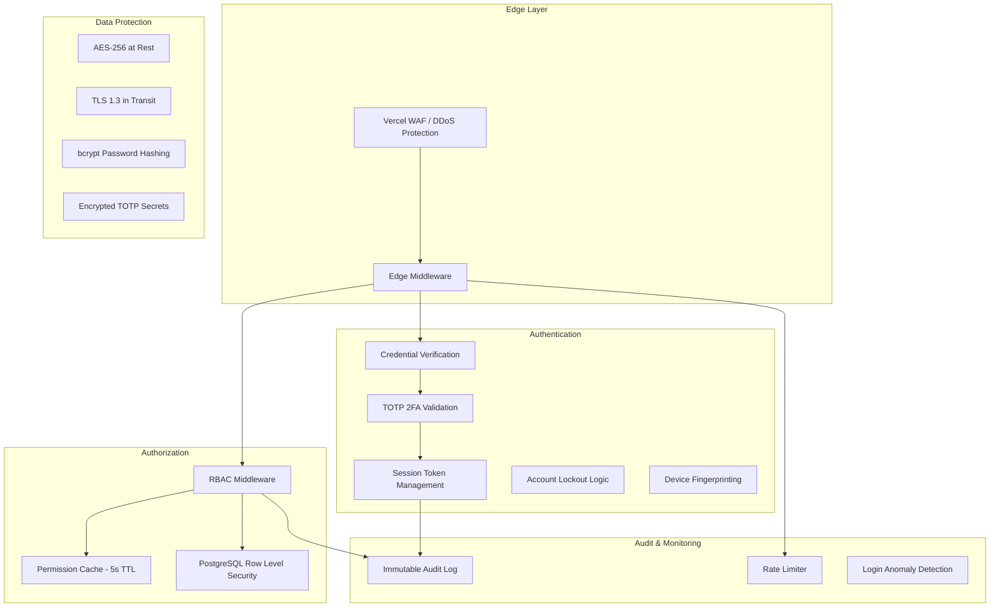

#### Security Controls

| Control | Implementation | Requirement |
|---------|---------------|-------------|
| Authentication | Email/password + TOTP 2FA | Req 1 |
| Session Management | Signed JWT, 30min idle, 8hr max | Req 1.3 |
| Account Lockout | 5 failures → 30min lock | Req 1.4 |
| 2FA Lockout | 3 invalid codes → 15min lock | Req 1.8 |
| New Device Detection | Fingerprint comparison + email alert | Req 1.7 |
| Permission Enforcement | API + Page + Component level | Req 2.1 |
| Permission Propagation | ≤5s after role change | Req 2.7 |
| Session Revocation | Immediate on role removal | Req 2.9 |
| Audit Immutability | DB triggers prevent UPDATE/DELETE | Req 3.2 |
| Data Retention | 7-year audit, 90-day login history | Req 3.4, 1.6 |
| Rate Limiting | 100 read/min, 30 write/min | Req 24.4 |
| Row Level Security | Supabase RLS enforcing RBAC | Req 24.3 |
| Input Validation | Zod schemas on all inputs | All mutations |
| XSS Prevention | React auto-escaping + CSP headers | All views |
| CSRF Protection | SameSite cookies + origin check | All mutations |

#### Password & Credential Security

```typescript
// Password requirements for temporary passwords
const TEMP_PASSWORD_CONFIG = {
  length: 12,
  includeUppercase: true,
  includeLowercase: true,
  includeDigits: true,
  includeSpecialChars: true,
  expiresAfterHours: 24,
};

// TOTP Configuration
const TOTP_CONFIG = {
  algorithm: 'SHA1',
  digits: 6,
  period: 30, // seconds
  window: 2,  // Allow 60s total window (code valid for ±1 period)
};

// Session Configuration
const SESSION_CONFIG = {
  idleTimeoutMs: 30 * 60 * 1000,    // 30 minutes
  maxAgeMs: 8 * 60 * 60 * 1000,     // 8 hours
  tokenAlgorithm: 'HS256',
};
```


### Scalability Strategy

#### Horizontal Scaling Architecture

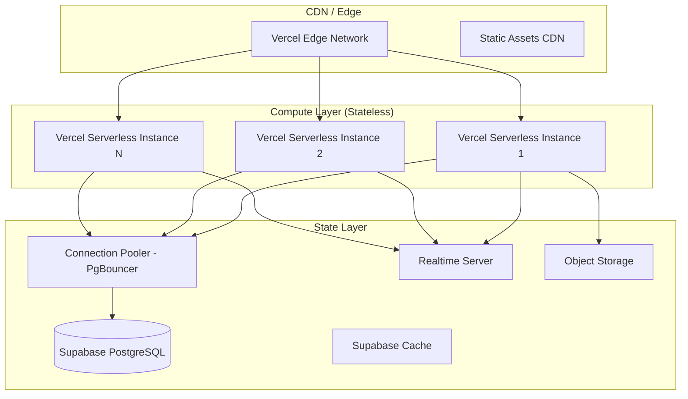

#### Scalability Decisions

| Concern | Strategy | Rationale |
|---------|----------|-----------|
| Application State | Stateless serverless functions | Enables horizontal scaling without affinity |
| Session State | Stored in Supabase `staff_sessions` | Centralized, accessible from any instance |
| Database Connections | PgBouncer connection pooling | Prevents connection exhaustion |
| Audit Data | Monthly partitioned tables | 7-year retention without performance degradation |
| Large Exports | Async job queue + Supabase Storage | Non-blocking, file served from object storage |
| Realtime | Supabase Realtime (multiplexed WebSocket) | Scales with Supabase infrastructure |
| Static Assets | Vercel Edge CDN | Global distribution, minimal latency |
| API Response Time | ≤200ms p95 target for 500 concurrent users | Validated via connection pooling + query optimization |
| Rate Limiting | Token bucket algorithm per staff member | Prevents abuse while allowing bursts |
| Query Performance | Strategic indexes + materialized views for analytics | Sub-3s queries on 30-day windows |

#### Performance Targets

| Metric | Target | Strategy |
|--------|--------|----------|
| API Response (p95) | ≤200ms | Connection pooling, indexed queries |
| Page Load (initial) | ≤2s | SSR + code splitting |
| Data Freshness | ≤5s | Supabase Realtime subscriptions |
| Search Response | ≤2s | Full-text search indexes (GIN) |
| Trade Query (30 days) | ≤3s | Partitioned tables + composite indexes |
| Concurrent Sessions | 500+ | Stateless design + connection pooling |
| Export (10k records) | Synchronous | Streamed CSV |
| Export (10k–500k records) | Async (background job) | Job queue + storage |

#### Database Optimization

```sql
-- Full-text search for global search (Ctrl+K)
ALTER TABLE users ADD COLUMN search_vector tsvector;
CREATE INDEX idx_users_search ON users USING GIN(search_vector);

UPDATE users SET search_vector = 
    to_tsvector('english', coalesce(email, '') || ' ' || 
    coalesce(username, '') || ' ' || 
    coalesce(first_name, '') || ' ' || 
    coalesce(last_name, '') || ' ' ||
    coalesce(phone, ''));

-- Materialized views for analytics dashboards
CREATE MATERIALIZED VIEW mv_revenue_daily AS
SELECT 
    date_trunc('day', created_at) AS day,
    challenge_type,
    COUNT(*) AS sales_count,
    SUM(amount) AS total_revenue,
    AVG(amount) AS avg_order_value
FROM purchases
GROUP BY 1, 2;

-- Refresh every 5 minutes via background job
-- REFRESH MATERIALIZED VIEW CONCURRENTLY mv_revenue_daily;

-- Partitioning for audit records (7-year retention)
CREATE TABLE audit_records (
    -- ... columns ...
) PARTITION BY RANGE (timestamp);

-- Create monthly partitions
CREATE TABLE audit_records_y2024m01 PARTITION OF audit_records
    FOR VALUES FROM ('2024-01-01') TO ('2024-02-01');
```


### Deployment Architecture

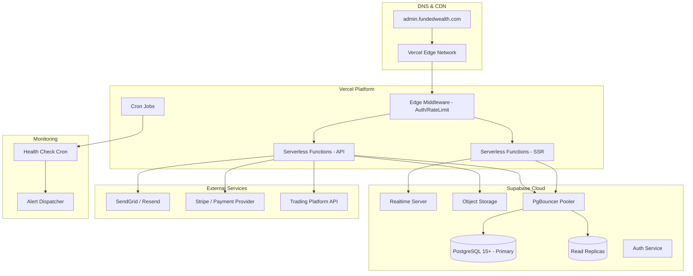

#### Deployment Strategy

| Aspect | Approach |
|--------|----------|
| Hosting | Vercel Pro/Enterprise |
| Database | Supabase Pro (dedicated instance) |
| Regions | Primary: Closest to trading servers |
| CI/CD | GitHub Actions → Vercel Preview → Production |
| Environments | Development → Staging → Production |
| Preview | PR-based preview deployments |
| Rollback | Instant via Vercel deployment history |
| Secrets | Vercel Environment Variables (encrypted) |
| Domain | `admin.fundedwealth.com` with Vercel DNS |

#### Cron Jobs (Vercel Cron)

| Job | Schedule | Purpose |
|-----|----------|---------|
| Health Check | Every 30s | Monitor service status |
| KYC Overdue Check | Every hour | Flag 48hr+ pending KYC |
| Risk Alert Escalation | Every minute | Escalate 15min unacknowledged alerts |
| Promotion Expiry | Every hour | Auto-expire ended promotions |
| Session Cleanup | Every 15 minutes | Remove expired sessions |
| Badge Count Refresh | Every 60s | Update sidebar badges |
| Analytics Materialization | Every 5 minutes | Refresh materialized views |
| Export Cleanup | Daily | Remove expired export files |
| Login History Cleanup | Daily | Remove records older than 90 days |


### Data Flow Diagrams

#### Authentication Flow

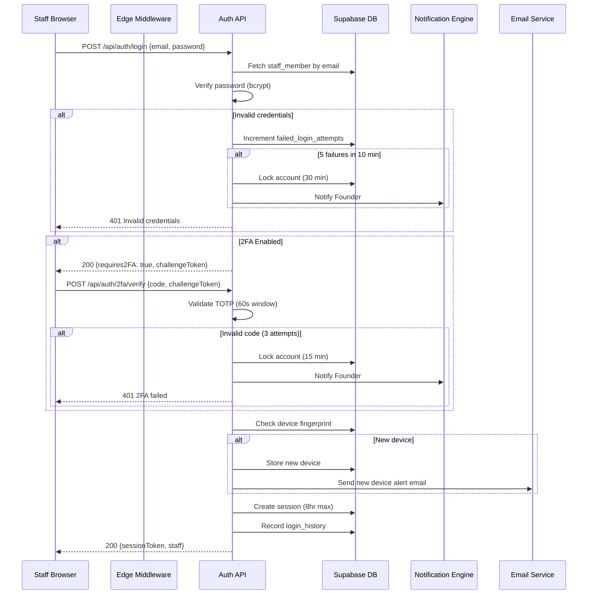

#### Payout Processing Flow

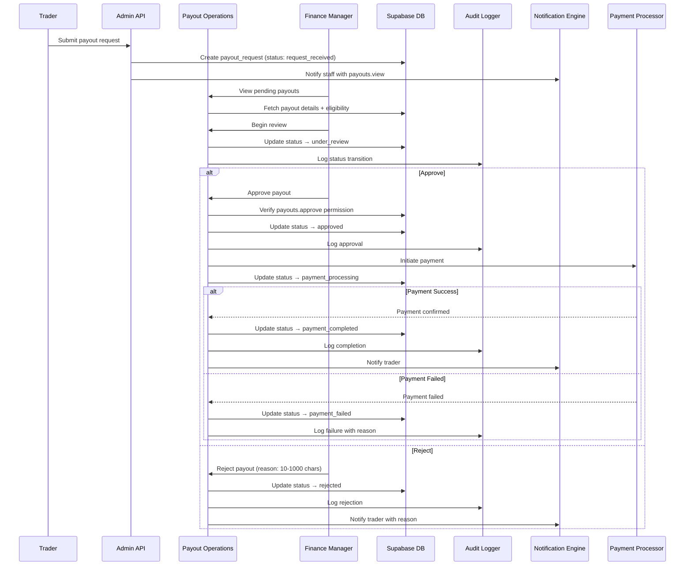

#### Real-Time Notification Flow

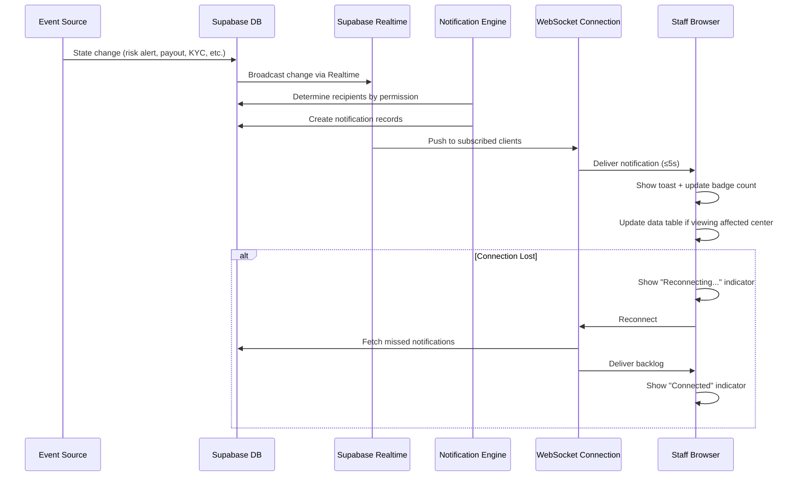

#### Data Export Flow

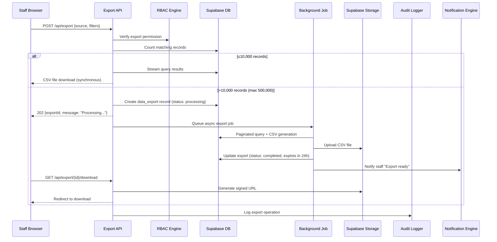


## Correctness Properties

*A property is a characteristic or behavior that should hold true across all valid executions of a system—essentially, a formal statement about what the system should do. Properties serve as the bridge between human-readable specifications and machine-verifiable correctness guarantees.*

### Property 1: Session Validity Enforcement

*For any* session token presented to the system, the session should be accepted if and only if: the token exists, has not been invalidated, has been active within the last 30 minutes, and was created no more than 8 hours ago. Any session failing these conditions should be rejected.

**Validates: Requirements 1.3**

### Property 2: Account Lockout Threshold

*For any* staff member account, if N consecutive failed authentication attempts occur within the configured time window (5 credential failures in 10 minutes, or 3 invalid 2FA codes consecutively), the account should transition to a locked state for the configured duration (30 minutes for credentials, 15 minutes for 2FA). During lockout, all authentication attempts should be rejected regardless of credential validity.

**Validates: Requirements 1.4, 1.8**

### Property 3: TOTP Time Window Validation

*For any* TOTP code and generation timestamp, the code should be accepted if and only if the current time is within 60 seconds of the code's generation time. Codes outside this window should be rejected.

**Validates: Requirements 1.2**

### Property 4: New Device Detection

*For any* login attempt, if the device fingerprint is not present in the staff member's list of known devices, the login should be flagged as a new device and trigger an email notification. If the fingerprint is already known, it should not be flagged.

**Validates: Requirements 1.7**

### Property 5: Login History Completeness

*For any* login event (successful or failed), the stored history record should contain all required fields: timestamp, IP address, device fingerprint, browser, operating system, and geolocation.

**Validates: Requirements 1.6**

### Property 6: RBAC Permission Enforcement

*For any* staff member and any action requiring a permission, if the staff member's effective permissions (the union of all permissions from all assigned roles) do not include the required permission, the action should be denied with a 403 response, and an audit record should be created documenting the denied attempt including the missing permission.

**Validates: Requirements 2.1, 2.6, 2.8**

### Property 7: Founder/Co-Founder Unrestricted Access

*For any* permission check and any staff member with the Founder or Co-Founder role, the check should always return true (access granted), regardless of which specific permission is being evaluated.

**Validates: Requirements 2.3**

### Property 8: Custom Role Validation

*For any* custom role creation attempt, it should succeed if and only if: the role name is between 3 and 50 characters, and the total number of existing custom roles is less than 50. Violations of either constraint should result in rejection.

**Validates: Requirements 2.5**

### Property 9: Multiple Role Permission Union

*For any* staff member assigned N roles, their effective permission set should equal the mathematical union of all permission sets from all N assigned roles. No permission should be lost or added beyond this union.

**Validates: Requirements 2.8**

### Property 10: Audit Record Completeness

*For any* state-changing action performed in the system, the created audit record should contain all required fields: actor identifier, actor role, action performed, UTC timestamp with millisecond precision, target entity type, target entity ID, previous state, new state, IP address, and device information. For bulk operations affecting N entities, exactly N audit records should be created sharing the same batch identifier.

**Validates: Requirements 3.1, 3.6**

### Property 11: Audit Query Correctness

*For any* audit query with a combination of filters (actor, action type, target entity, date range, IP address), every returned record should satisfy all specified filter conditions. Results should be in reverse chronological order with a maximum of 100 records per page.

**Validates: Requirements 3.3**

### Property 12: Text Length Validation

*For any* text input with configured minimum and maximum length constraints (internal notes: 10-5000 chars, action reasons: 10+ chars, challenge justifications: 20+ chars, rejection reasons: 10-1000 chars, escalation reasons: 10+ chars), the system should accept the input if and only if the character count is within the configured bounds.

**Validates: Requirements 5.4, 5.6, 6.3, 6.4, 8.5, 15.3**

### Property 13: User Search Match

*For any* user in the system and any search query of 3 or more characters, the user should appear in search results if and only if the query partially matches their email, username, user ID, phone number, or trading account number.

**Validates: Requirements 5.1**

### Property 14: Timeline Ordering and Limit

*For any* entity's event timeline, events should be displayed in reverse chronological order, limited to the configured maximum (50 for user timelines, 20 for activity feeds). The returned events should be the N most recent from the complete event set.

**Validates: Requirements 5.5, 4.2**

### Property 15: Challenge Pass Criteria Evaluation

*For any* challenge account, it should be flagged for review (pass criteria met) if and only if: profit target percentage is achieved, daily and maximum drawdown limits are compliant, and minimum trading days are completed. If any criterion is not met, the account should not be flagged.

**Validates: Requirements 6.2**

### Property 16: State Machine Transition Validity

*For any* entity with a defined state machine (challenge accounts, payout requests, risk alerts, KYC submissions, support tickets), a state transition should succeed if and only if the target state is a valid successor of the current state. Invalid transitions should be rejected with an error indicating the current state and permitted transitions.

**Validates: Requirements 6.7, 8.2, 10.3, 9.3**

### Property 17: Challenge Reset Data Preservation

*For any* challenge account reset operation, the original account data (trade history, performance metrics, rule compliance status) should remain accessible in history, and the new evaluation period should have identical duration and rules to the original challenge configuration.

**Validates: Requirements 6.6**

### Property 18: Drawdown Breach Detection

*For any* funded account where daily drawdown or maximum drawdown exceeds the configured limit percentage, the system should generate a risk alert with the correct severity level, breach type, breach amount, and threshold that was violated.

**Validates: Requirements 7.2, 10.1**

### Property 19: Profit Share Calculation

*For any* funded account with a profit amount P and configured profit split percentage S, the trader's share should equal P × (S / 100) and the firm's share should equal P − trader's share. The sum of both shares should always equal the total profit.

**Validates: Requirements 7.3**

### Property 20: Payout Eligibility Determination

*For any* funded trader, payout eligibility should be true if and only if all of the following conditions are met: minimum trading days completed, profit threshold reached, no active violations, and KYC status is verified. If any condition fails, eligibility should be false with the specific reason.

**Validates: Requirements 7.4**

### Property 21: Payout Rejection Reason Bounds

*For any* payout rejection, it should be accepted if and only if the rejection reason is between 10 and 1000 characters. Reasons outside this range should cause the rejection to fail.

**Validates: Requirements 8.5**

### Property 22: Payout Aggregate Analytics

*For any* set of payout records, the computed aggregates should be mathematically correct: total paid = sum of all completed payouts, pending = sum of non-completed payouts, average processing time = mean of (completed_at - created_at) for completed payouts, and rejection rate = rejected count / total count × 100.

**Validates: Requirements 8.8**

### Property 23: KYC Resubmission Limit

*For any* KYC submission, resubmission should be allowed if and only if the submission count is less than 3. If submission count equals 3, the submission should require manual escalation rather than allowing further resubmission.

**Validates: Requirements 9.6**

### Property 24: KYC Overdue Detection

*For any* KYC submission in pending status, it should be marked as overdue if and only if the elapsed time since creation exceeds 48 hours. Submissions reviewed within 48 hours should not be marked overdue.

**Validates: Requirements 9.7**

### Property 25: Risk Alert Severity Sort

*For any* set of risk alerts, the default display order should sort by severity descending (critical > high > medium > low), then by creation timestamp descending within the same severity level.

**Validates: Requirements 10.2**

### Property 26: Risk Alert Escalation

*For any* risk alert in "open" status that has not been acknowledged within 15 minutes of generation, its severity should be escalated by one tier (low→medium, medium→high, high→critical). Critical alerts cannot be escalated further.

**Validates: Requirements 10.7**

### Property 27: Trade Filter AND Logic

*For any* combination of active filters applied to the trade list (account, trader, symbol, direction, date range, P&L range, lot size range, duration range), every returned trade should satisfy all filter conditions simultaneously. No trade violating any active filter should appear in results.

**Validates: Requirements 11.2**

### Property 28: Trade Statistics Correctness

*For any* set of trades for an account, the computed statistics should be mathematically correct: win rate = winning trades / total trades × 100, average profit = sum of positive P&L / count of winning trades, average loss = sum of negative P&L / count of losing trades, profit factor = sum of gains / sum of losses.

**Validates: Requirements 11.3, 11.5**

### Property 29: Commission Calculation

*For any* purchase by a referred user and any commission structure (flat rate, percentage, tiered by volume, recurring), the calculated commission should match the configured formula: flat = configured amount, percentage = purchase × rate / 100, tiered = rate determined by volume tier, recurring = calculated on each repeat purchase by the referred user.

**Validates: Requirements 13.2, 13.3**

### Property 30: Commission Reversal on Refund

*For any* refunded purchase with an associated affiliate commission, the affiliate's pending balance should decrease by exactly the original commission amount, and an audit record should document the reversal.

**Validates: Requirements 13.6**

### Property 31: SLA Breach Detection

*For any* support ticket in "open" or "in-progress" status, it should be flagged as "SLA-breached" if and only if the elapsed time exceeds the configured SLA threshold for its priority level (each priority has a different threshold).

**Validates: Requirements 15.6**

### Property 32: Marketing Entity Validation

*For any* promotion or coupon creation, it should succeed if and only if: discount value is within bounds (1-100 for percentage, 0.01-999,999.99 for fixed), coupon code is 4-32 alphanumeric characters and unique, usage limits are within configured bounds, and all required fields are provided. Invalid values should cause rejection with a specific error message.

**Validates: Requirements 16.1, 16.3, 16.4**

### Property 33: Certificate Eligibility

*For any* certificate generation request, it should succeed if and only if the trader has a corresponding passed challenge (for challenge completion certificates) or active funded account (for funded trader certificates). Requests without valid eligibility should be rejected.

**Validates: Requirements 17.4**

### Property 34: Background Job Retry Limit

*For any* background job that fails, retry attempts should be limited to a maximum of 3. After exhausting all 3 retries, the job should transition to "permanently_failed" status and trigger an alert notification.

**Validates: Requirements 18.5, 18.7**

### Property 35: Staff Account Creation Validation

*For any* staff member creation request, it should succeed if and only if: email is valid format and unique, name is 1-100 characters, and the generated temporary password contains at least 12 characters including uppercase, lowercase, digits, and special characters with a 24-hour expiry.

**Validates: Requirements 19.1, 19.2**

### Property 36: Configuration Value Validation

*For any* configuration change attempt, it should succeed if and only if the new value satisfies the defined business rule constraints (minimum/maximum bounds, valid formats). Invalid values should preserve the existing configuration and return a specific error indicating which constraint was violated.

**Validates: Requirements 20.6**

### Property 37: Rate Limit Enforcement

*For any* staff member making API requests, if the number of requests within the current 1-minute window exceeds the configured limit (100 for reads, 30 for writes), subsequent requests should be rejected with a 429 status indicating the number of seconds until the limit resets.

**Validates: Requirements 24.4, 24.5**

### Property 38: Navigation Permission Filtering

*For any* staff member, the sidebar navigation should display only the operating centers for which the staff member holds the corresponding view permission. Search results should similarly exclude entities the staff member cannot access.

**Validates: Requirements 22.5**

### Property 39: Global Search Grouping

*For any* search query of 2 or more characters, results should be grouped by entity type with a maximum of 5 results per group. If more results exist for a type, a "view all" option should be available.

**Validates: Requirements 22.2**

### Property 40: Async Export Threshold

*For any* data export request, if the record count exceeds 10,000, the system should process the export asynchronously. The total export is capped at 500,000 records maximum. Exports of 10,000 or fewer records should be processed synchronously.

**Validates: Requirements 23.2, 23.6**


## Error Handling

### Error Response Format

All API errors follow a consistent structure:

```typescript
interface ApiError {
  code: string;           // Machine-readable error code
  message: string;        // Human-readable description
  details?: Record<string, string>; // Field-level validation errors
  retryAfter?: number;    // Seconds until retry allowed (rate limiting)
}

// HTTP Status Code Mapping
// 400 - Validation errors (invalid input, constraint violations)
// 401 - Authentication required (expired session, invalid token)
// 403 - Permission denied (insufficient RBAC permissions)
// 404 - Resource not found
// 409 - Conflict (duplicate email, concurrent edit)
// 422 - Business rule violation (invalid state transition)
// 429 - Rate limit exceeded
// 500 - Internal server error
// 503 - Service unavailable (external service down)
```

### Error Handling Strategy by Layer

| Layer | Strategy | Recovery |
|-------|----------|----------|
| Edge Middleware | Rate limit → 429, Auth fail → 401, Permission → 403 | Return error response |
| API Route Handler | Input validation → 400, Business rule → 422 | Return error with details |
| Service Layer | State conflicts → 409, External fail → 503 | Retry or graceful degradation |
| Repository Layer | DB errors → 500, Constraint violation → 409 | Log and propagate |
| UI Layer | Optimistic revert, error toast, retry button | Display error state |

### Optimistic UI Error Recovery

```typescript
// Optimistic update pattern with rollback
async function optimisticMutation<T>(
  // Immediately update UI
  optimisticUpdate: () => void,
  // Execute server mutation
  serverMutation: () => Promise<T>,
  // Revert if server rejects (within 2 seconds)
  rollback: () => void,
  // Show error to user
  onError: (error: ApiError) => void,
): Promise<T | null> {
  optimisticUpdate();
  try {
    return await serverMutation();
  } catch (error) {
    rollback();
    onError(error as ApiError);
    return null;
  }
}
```

### Error Scenarios by Domain

| Scenario | Error Code | User Experience |
|----------|-----------|-----------------|
| Session expired (idle) | `SESSION_IDLE_TIMEOUT` | Redirect to login with message |
| Session expired (max age) | `SESSION_MAX_AGE` | Redirect to login with message |
| Account locked | `ACCOUNT_LOCKED` | Show lockout duration remaining |
| Permission denied | `PERMISSION_DENIED` | Toast notification + audit log |
| Invalid state transition | `INVALID_TRANSITION` | Error message with valid transitions |
| Rate limit exceeded | `RATE_LIMIT_EXCEEDED` | Toast with countdown to reset |
| Export too large | `EXPORT_LIMIT_EXCEEDED` | Suggest narrowing filters |
| Validation failure | `VALIDATION_ERROR` | Inline field errors |
| External service down | `SERVICE_UNAVAILABLE` | Staleness indicator + retry button |
| Concurrent edit conflict | `CONFLICT` | Show diff + merge options |
| Realtime disconnected | `WS_DISCONNECTED` | Connection status indicator |
| Data load timeout (>300ms) | N/A | Loading skeleton |
| Data load failure | `DATA_LOAD_ERROR` | Error state with retry action |
| Empty results | N/A | Empty state with descriptive message |

### Graceful Degradation

When external services are unavailable:
- **Payment processor down**: Payout approvals queued, status shown as "payment pending"
- **Email service down**: Notifications queued for retry, in-app notifications continue
- **Trading platform API down**: Staleness indicator on trade data, cached data shown
- **Realtime connection lost**: Connection indicator shown, periodic polling fallback


## Testing Strategy

### Testing Approach

The system uses a dual testing approach combining unit/example-based tests with property-based tests for comprehensive coverage.

### Test Framework Stack

| Tool | Purpose |
|------|---------|
| Vitest | Unit and integration test runner |
| fast-check | Property-based testing library |
| Testing Library | Component testing |
| Playwright | E2E testing |
| MSW (Mock Service Worker) | API mocking |

### Property-Based Testing Configuration

- **Library**: fast-check
- **Minimum iterations**: 100 per property test
- **Tag format**: `Feature: fundedwealth-admin-os, Property {number}: {title}`

Each correctness property maps to a single property-based test:

```typescript
// Example: Property 1 - Session Validity Enforcement
import { fc } from 'fast-check';

describe('Feature: fundedwealth-admin-os, Property 1: Session Validity Enforcement', () => {
  it('should accept valid sessions and reject expired ones', () => {
    fc.assert(
      fc.property(
        fc.record({
          createdAt: fc.date({ min: new Date('2024-01-01'), max: new Date('2025-12-31') }),
          lastActivity: fc.date({ min: new Date('2024-01-01'), max: new Date('2025-12-31') }),
          invalidated: fc.boolean(),
          currentTime: fc.date({ min: new Date('2024-01-01'), max: new Date('2025-12-31') }),
        }),
        ({ createdAt, lastActivity, invalidated, currentTime }) => {
          const isValid = validateSession({ createdAt, lastActivity, invalidated }, currentTime);
          
          const idleMs = currentTime.getTime() - lastActivity.getTime();
          const ageMs = currentTime.getTime() - createdAt.getTime();
          const expectedValid = !invalidated 
            && idleMs <= 30 * 60 * 1000 
            && ageMs <= 8 * 60 * 60 * 1000
            && lastActivity >= createdAt;
          
          return isValid === expectedValid;
        }
      ),
      { numRuns: 100 }
    );
  });
});
```

### Unit Test Coverage Targets

| Module | Unit Tests Focus |
|--------|-----------------|
| Auth | Login flow, 2FA setup, device detection |
| RBAC | Role assignment, permission checking, cache invalidation |
| Audit | Record creation, query filtering, immutability |
| Session | Creation, validation, refresh, invalidation |
| Payouts | Workflow transitions, eligibility checks |
| KYC | Document validation, status transitions |
| Risk | Alert generation, escalation timing |
| Export | CSV generation, size thresholds |
| Config | Versioning, validation, rollback |

### Integration Test Coverage

| Area | What's Tested |
|------|--------------|
| Auth Flow | Full login → 2FA → session → logout |
| RBAC + API | Permission enforcement across endpoints |
| Audit Immutability | DB triggers preventing modification |
| Realtime | WebSocket notification delivery |
| RLS Policies | Row-level security enforcement |
| Export Pipeline | Async job → storage → download |
| Health Checks | Service monitoring and alerting |

### E2E Test Scenarios (Playwright)

| Scenario | Critical Path |
|----------|--------------|
| Staff Login | Credentials → 2FA → Dashboard access |
| Payout Approval | View → Review → Approve → Verify audit |
| KYC Review | Open → Review docs → Approve → Status update |
| Challenge Management | View → Pass/Fail → Verify state change |
| Role Management | Create role → Assign → Verify access |
| Global Search | Ctrl+K → Type → Navigate to result |
| Data Export | Apply filters → Export → Download |

### Test Organization

```
tests/
├── unit/
│   ├── lib/
│   │   ├── rbac/
│   │   │   ├── engine.test.ts
│   │   │   └── engine.property.test.ts     # Property tests
│   │   ├── session/
│   │   │   ├── validator.test.ts
│   │   │   └── validator.property.test.ts
│   │   ├── audit/
│   │   │   ├── logger.test.ts
│   │   │   └── logger.property.test.ts
│   │   └── rate-limit/
│   │       └── limiter.property.test.ts
│   └── modules/
│       ├── payouts/
│       │   ├── services.test.ts
│       │   └── services.property.test.ts
│       ├── challenges/
│       │   └── state-machine.property.test.ts
│       ├── risk/
│       │   └── escalation.property.test.ts
│       ├── affiliates/
│       │   └── commission.property.test.ts
│       └── marketing/
│           └── validation.property.test.ts
├── integration/
│   ├── auth.test.ts
│   ├── rbac-api.test.ts
│   ├── audit-immutability.test.ts
│   ├── realtime.test.ts
│   └── export-pipeline.test.ts
└── e2e/
    ├── login.spec.ts
    ├── payout-workflow.spec.ts
    ├── kyc-review.spec.ts
    └── search.spec.ts
```

